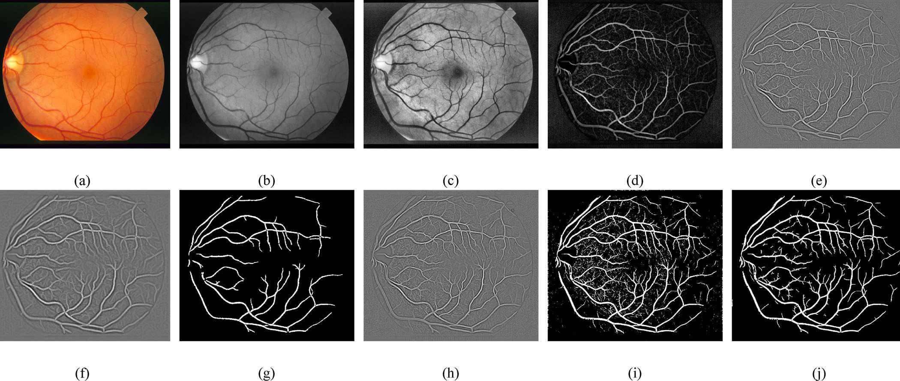

# Retinal Blood Vessel Segmentation

A Python implementation of the unsupervised retinal blood vessel segmentation and denoising framework proposed by **Khan et al. (*PLOS ONE*, 2016)**, evaluated on the **DRIVE** (Digital Retinal Images for Vessel Extraction) dataset.

📄 **Reference Paper:** [A Morphological Hessian Based Approach for Retinal Blood Vessels Segmentation and Denoising Using Region Based Otsu Thresholding](https://doi.org/10.1371/journal.pone.0158996)

---

## Visual Pipeline Overview

**Main processing stages of the segmentation framework:**
* **(a)** Original RGB retinal fundus input image
* **(b)** Extracted Green channel (exhibiting highest vessel-to-background contrast)
* **(c)** Local contrast enhancement via **CLAHE**
* **(d)** Low-frequency noise and geometrical object removal using **Modified Morphological Top-Hat** filtering
* **(e)** Thin vessel enhanced image via **Hessian Matrix & Eigenvalues** ($\sigma_1 = 1$)
* **(f)** Wide vessel enhanced image via **Hessian Matrix & Eigenvalues** ($\sigma_2 = 2.5$)
* **(g)** Binary map of wide vessels obtained via **Global Otsu Thresholding**
* **(h)** Wavelet-based **Image Fusion (2D-DWT)** of the thin vessel enhanced image and global thresholding output
* **(i)** **Region-Based Local Otsu Thresholding** with spatial offset adjustment to capture thin vasculature
* **(j)** Final binary segmented image after **Post-processing** (connected-component area filtering)

---

## Repository Structure

| File | Description |
| :--- | :--- |
| `RetinalSegmentation.ipynb` | Complete Jupyter Notebook containing the step-by-step Python implementation and visualizations |
| `Project Report.pdf` | Detailed technical report (in Persian) explaining the mathematical formulation and intermediate outputs |
| `img.jpg` | Step-by-step visual overview of the vessel extraction pipeline |
